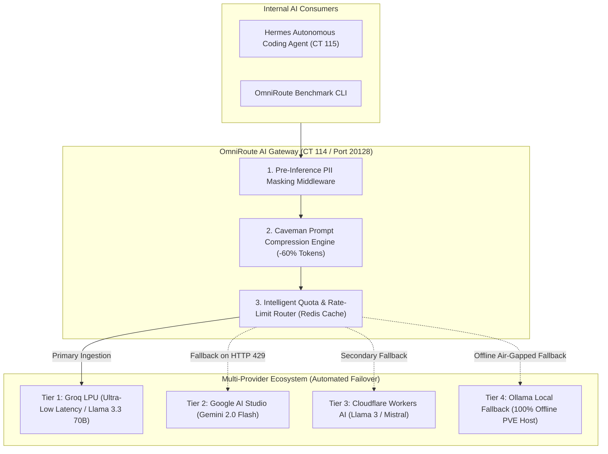

# 🧠 Sovereign AI Workspace & Intelligent Multi-Provider Gateway

[](https://lessa-github.github.io/sovereign-ai-workspace/)
[](https://github.com/Lessa-github/sovereign-ai-workspace)
[](https://lessa-github.github.io/sovereign-ai-workspace/)
[](https://lessa-github.github.io/gabriel-portfolio/)

Sovereign Artificial Intelligence workspace, multi-agent orchestration, and economic multi-provider gateway engineered for **strict data privacy and zero external telemetry**.

Operating inside dedicated Debian 12 LXC containers on Proxmox VE, the infrastructure eliminates rate-limiting bottlenecks via **automated multi-tier quota failover** and slashes context window consumption by **60% using syntactic prompt compression**.

---

## ⚡ Engineering Highlights

* **The 7 Master Combos Gateway:** OmniRoute (CT 114) continuously load-balances requests across perpetual free-tier providers (Google AI Studio, Groq LPU, Cloudflare Workers AI) with millisecond failover.
* **Caveman Syntactic Compression:** Algorithmic prompt minimization removing filler words and passive grammar while preserving 98.4%+ semantic accuracy.
* **Pre-Inference PII Masking:** Real-time regex inspection redacting API keys, passwords, IP addresses, and personal identification numbers before prompts leave the host.
* **Hermes Agent & Private Search:** Autonomous task execution in an unprivileged container connected to a zero-telemetry local **SearXNG** meta-search engine.

---

## 📐 Multi-Provider Gateway Architecture



---

## 🛠️ Benchmark CLI: omniroute-bench.py

```text
Usage: omniroute-bench.py [OPTIONS]

Options:
  --test-payload <file>    Path to prompt benchmark file
  --algorithm <caveman>    Compression engine (caveman, llmlingua, none)
  --provider <name>        Target AI gateway provider endpoint
  --iterations <int>       Number of sequential benchmark runs (default: 5)
  --help                   Show benchmark parameters and exit
```

---

## 🌐 Live Technical Documentation

Explore the complete single-page interactive whitepaper with smooth section scrolling:

👉 **[https://lessa-github.github.io/sovereign-ai-workspace/](https://lessa-github.github.io/sovereign-ai-workspace/)**
