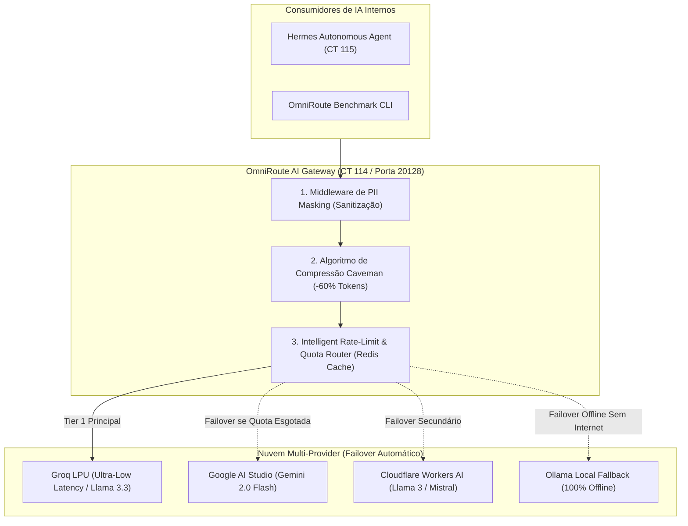

# 🧠 Sovereign AI Workspace & Intelligent Multi-Provider Gateway

[](https://lessa-github.github.io/sovereign-ai-workspace/)
[](https://github.com/Lessa-github/sovereign-ai-workspace)
[](https://lessa-github.github.io/sovereign-ai-workspace/)
[](https://lessa-github.github.io/gabriel-portfolio/)

Plataforma de infraestrutura de Inteligência Artificial soberana, orquestração de agentes autônomos e roteamento econômico multi-provedor com **privacidade total e zero telemetria externa**.

Projetado para operar em contêineres Debian 12 LXC dedicados no Proxmox VE, eliminando gargalos de cotas via failover automático para tiers perpétuos gratuitos e reduzindo o consumo de tokens de contexto em até **60% via algoritmos de compressão semântica**.

---

## ⚡ Destaques de Engenharia

* **Roteamento Inteligente em 7 Combos:** O gateway **OmniRoute (CT 114)** realiza failover contínuo e sem interrupções entre múltiplos provedores com cotas gratuitas perpétuas (Google AI Studio, Groq LPU, Cloudflare Workers AI) com governança de limites de RPM/RPD.
* **Compressão de Prompt Caveman:** Algoritmo que elimina stopwords e tokens redundantes, diminuindo o consumo de janela de contexto em 60% com perda semântica próxima de zero.
* **Middleware de PII Masking:** Sanitização pré-inferência que anonimiza senhas, chaves de API, CPFs e dados sensíveis antes de qualquer tráfego sair para APIs de IA.
* **Agente Autônomo Hermes (CT 115):** Ambiente de execução isolado equipado com suporte a ferramentas MCP e integrado a uma instância local do buscador **SearXNG** para pesquisa na internet sem rastreamento comercial.

---

## 📐 Arquitetura do Gateway Multi-Provider



---

## 🛠️ CLI Benchmark: `omniroute-bench.py`

O repositório inclui a ferramenta de teste e benchmarking de compressão de contexto:

```bash
$ python3 cli-tools/omniroute-bench.py --help
Usage: omniroute-bench.py [OPTIONS]

Options:
  --test-payload <file>    Path to prompt benchmark file
  --algorithm <caveman>    Compression engine (caveman, llmlingua, none)
  --provider <name>        Target AI gateway provider endpoint
  --iterations <int>       Number of sequential benchmark runs (default: 5)
  --help                   Show benchmark parameters and exit
```

---

## 🌐 Documentação Web Completa (Live Docsify)

👉 **[https://lessa-github.github.io/sovereign-ai-workspace/](https://lessa-github.github.io/sovereign-ai-workspace/)**
