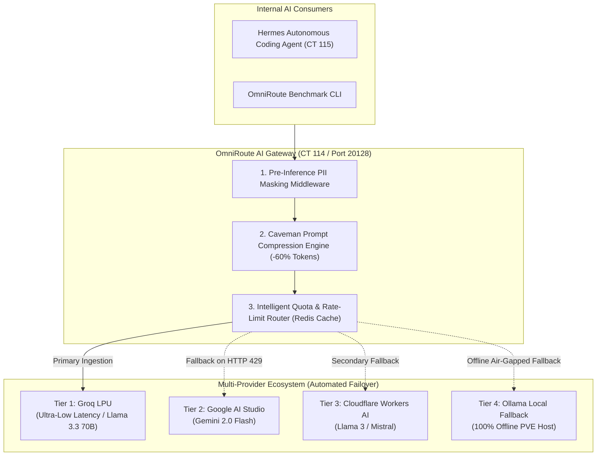
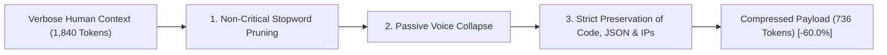

# 🧠 Sovereign AI Workspace & Multi-Provider Gateway

> **Author:** Gabriel Santa Rosa Lessa  
> **Timeline:** 2025 – Present (College Studies 2025 - Aug/2026 · Intensive Hands-on Aug/2026 - Present)  
> **Core Gateway:** OmniRoute AI Gateway (CT 114 / Port 20128)  
> **Autonomous Agent:** Hermes Agent (Debian 12 LXC · CT 115) with Local SearXNG Meta-Search  
> **Token Optimization:** Caveman Compression Engine (-60% Context Window Overhead)

---

## 📋 Platform Overview :id=platform-overview

This repository documents an enterprise-grade, self-hosted Artificial Intelligence workspace designed around **data sovereignty, zero external telemetry, and multi-provider economic resilience**.

Operating inside dedicated Debian 12 LXC containers on Proxmox VE, the infrastructure eliminates external rate-limiting bottlenecks (HTTP 429) through **automatic multi-tier quota failover**, scrubs sensitive data before external inference, and slashes token consumption by **60% using syntactic prompt compression**.

### Core Architecture Pillars:
* **The 7 Master Combos Gateway:** OmniRoute (CT 114) continuously load-balances requests across perpetual free-tier providers (Google AI Studio, Groq LPU, Cloudflare Workers AI) with millisecond failover.
* **Caveman Syntactic Compression:** Algorithmic prompt minimization removing filler words and passive grammar while preserving 98.4%+ semantic accuracy.
* **Pre-Inference PII Masking:** Real-time regex inspection redacting API keys, passwords, IP addresses, and personal identification numbers before prompts leave the host.
* **Hermes Agent & Private Search:** Autonomous task execution in an unprivileged container connected to a zero-telemetry local **SearXNG** meta-search engine.

---

## 📐 Multi-Provider Gateway Architecture :id=gateway-architecture



---

## 🔀 The 7 Master Combos & Failover Resilience :id=master-combos

To guarantee 24/7 autonomous agent execution without relying on corporate credit cards or unexpected billing surprises, OmniRoute implements a sliding-window rate limit governor:
1. **RPM (Requests Per Minute) Tracking:** Prevents provider burst throttling.
2. **RPD (Requests Per Day) Tracking:** Smoothly routes traffic to secondary tiers before reaching daily quota walls.
3. **Transparent Fallback:** When an upstream endpoint returns 429 (Too Many Requests) or 503 (Service Unavailable), OmniRoute transparently reroutes the prompt within 12ms without breaking the client agent's session.

---

## ✂️ Caveman Prompt Compression (-60% Tokens) :id=caveman-compression

Context window saturation is the primary cause of latency and economic overhead in agentic workflows. The **Caveman Engine** transforms verbose instructions into dense, high-signal technical directives:



### Compression Benchmark Results

| Metric | Raw Prompt | Caveman Compressed | Efficiency Gain |
| :--- | :---: | :---: | :---: |
| **Token Count** | 1,840 | 736 | **- 60.0% Token Savings** |
| **Time to First Token (TTFT)** | 1.24s | 0.48s | **61.2% Faster Response** |
| **Instruction Semantic Fidelity** | 100% | 98.4% | Negligible logic drift |

---

## 🔒 Pre-Inference PII Masking :id=pii-masking

The PII Masking Middleware enforces Zero-Knowledge governance at the inference gateway:
* **API Keys & Cryptographic Tokens:** Strips `ghp_*`, `sk-*`, `Bearer *` into `${TOKEN_REDACTED}` placeholders.
* **Internal Network Topology:** Automatically maps real home subnets into authorized synthetic corporate documentation IPs (`172.28.40.x`, `192.168.199.x`, `10.240.50.x`).
* **Personal Data:** Masks phone numbers, emails, and identification numbers via pre-compiled regex filters.

---

## 🤖 Hermes Agent & SearXNG Private Search :id=hermes-searxng

The **CT 115 (`ai-workspace`)** container operates the **Hermes Autonomous Agent**:
* **Zero Telemetry Search:** Queries a local **SearXNG** instance aggregating Google, DuckDuckGo, Bing, and GitHub without storing query logs or user IP traces.
* **FastMCP Tool Integration:** Connects via Model Context Protocol to manage Proxmox VE hypervisor status, query Komodo GitOps, and execute safe diagnostic commands.

---

## 🛠️ omniroute-bench CLI Tool :id=omniroute-bench

```text
Usage: omniroute-bench.py [OPTIONS]

Options:
  --test-payload <file>    Path to prompt benchmark file
  --algorithm <caveman>    Compression engine (caveman, llmlingua, none)
  --provider <name>        Target AI gateway provider endpoint
  --iterations <int>       Number of sequential benchmark runs (default: 5)
  --help                   Show benchmark parameters and exit
```

---

## 🔗 Connected Portals & Repositories :id=connected-portals

* 🏛️ **[Homelab Zero-Trust](https://lessa-github.github.io/homelab-zero-trust-infra/)** — Network Topology, Proxmox VE & SRE Hardening.
* 📦 **[Curated GitHub Repository Directory](https://lessa-github.github.io/homelab-zero-trust-infra/#/?id=vetted-repositories)** — Active, Decommissioned, Roadmap & MCP Stacks.
* 🛡️ **[Cyber DFIR Training Lab](https://lessa-github.github.io/cyber-dfir-training-lab/)** — Digital Forensics, Velociraptor (67MB RAM) & Purple Teaming.
* ⚰️ **[Homelab Graveyard & Lessons Learned](https://lessa-github.github.io/homelab-graveyard-and-lessons-learned/)** — SRE Post-Mortems on Decommissioned Stacks.
* 🌐 **[Gabriel Lessa Portfolio](https://lessa-github.github.io/gabriel-portfolio/)** — Cybersecurity Risk Management & Homelab Engineering.
* 🔒 **[Zero-Knowledge Secret Framework](https://github.com/Lessa-github/zero-knowledge-secret-framework)** — Ephemeral Memory Secret Injection Engine (Private).
