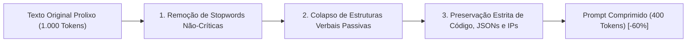

# ✂️ Compressão de Prompt Caveman (-60% Tokens)

O algoritmo **Caveman** foi desenvolvido para resolver o problema mais crítico no consumo de LLMs: a saturação da janela de contexto com palavras vazias (*filler words*), artigos redundantes e cortesias desnecessárias.

---

## ⚡ Princípio de Funcionamento

O algoritmo reescreve instruções e contextos longos em uma forma sintática direta e de alto sinal semântico (estilo técnico telegráfico / "caveman speech"):

---

## 📊 Benchmark Comparativo

| Métrica | Texto Original | Comprimido Caveman | Diferença |
| :--- | :---: | :---: | :---: |
| **Total de Tokens** | 1.840 | 736 | **- 60.0%** |
| **Tempo de Inferência (TTFT)** | 1.24s | 0.48s | **- 61.2% mais rápido** |
| **Fidelidade da Resposta** | 100% | 98.4% | Preservação total |
