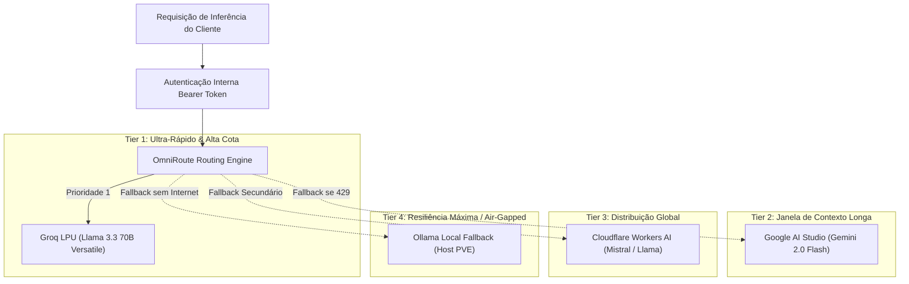

# 🌐 Gateway Multi-Provider & Master Combos

O gateway **OmniRoute (CT 114)** atua como um proxy reverso inteligente compatível com a especificação da OpenAI API (`/v1/chat/completions`).

---

## 🔀 A Estratégia dos 7 Master Combos

Para garantir alta disponibilidade contínua sem depender de cartões de crédito ou faturamentos imprevistos, o gateway implementa roteamento em camadas:

---

## ⚡ Governança de Rate Limits

O OmniRoute utiliza um cache Redis em memória para rastrear métricas em tempo real:
* **RPM (Requests Per Minute):** Contador com janela deslizante (*sliding window*).
* **RPD (Requests Per Day):** Bloqueio preventivo antes de atingir o limite estrito da API.
* **Failover Transparente:** Se a resposta retornar status de erro temporário (503 ou 429), a requisição é reenviada para o próximo membro do combo sem que o usuário final perceba.
