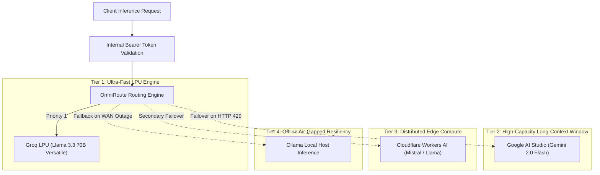

# 🌐 Multi-Provider AI Gateway & The 7 Master Combos

The **OmniRoute Gateway (CT 114)** functions as an intelligent, high-availability reverse proxy adhering strictly to the standard OpenAI API specification (`/v1/chat/completions`).

---

## 🔀 Layered Master Combos Routing Strategy

To deliver uninterrupted high availability without credit card dependencies or unpredictable cloud billing spikes, the gateway implements a deterministic four-tier cascade:

---

## ⚡ Rate Limit Governance & Quota Protection

OmniRoute leverages in-memory Redis telemetry to enforce precise quota boundaries:
* **RPM (Requests Per Minute):** Sliding window token bucket counters preventing short-term burst saturation.
* **RPD (Requests Per Day):** Proactive cutoff triggers preventing vendor account throttling.
* **Transparent Failover:** When an upstream vendor returns temporary service degradation (HTTP 429 or 503), the gateway reroutes the in-flight payload to the next combo provider with zero client disruption.
